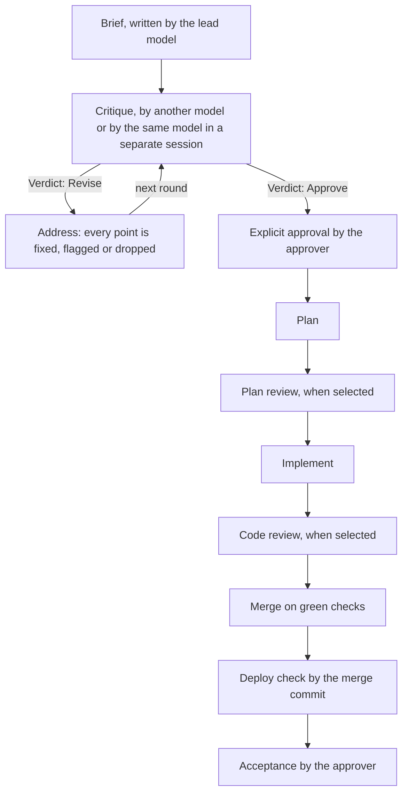

# Bollplank

Bollplank is a workflow kit for Claude Code and Codex. One model writes a ticket's brief, a model from another vendor critiques it, the author answers every point, and a named person approves it before anything is built. After approval, a ticket run takes the ticket from plan to shipped, with review gates on the way.

The method comes from the article [Two Models and an Engineer](https://neologic.se/articles/two-models-and-an-engineer/). Its claim is that when code is cheap, the bottleneck moves to the specification, so the specification is where review pays off.

Bollplank is Swedish for a sounding board.

## The loop



The approver can approve after any round. A critic's Approve verdict ends the rounds but is not an approval. The brief's `Cross-model review` line, settled at approval, says whether the plan review, the code review, both or neither run as gates.

## An example ticket

This is an illustration. Acme, the ticket and every name in it are made up. The model names show the shape of the lines and depend on what your clients run.

**The brief**, in the issue's description:

```text
Brief v1
Responsible: Claude Code
Model: Claude Opus 5.5, effort high
Workflow: Bollplank 0.1.0, build 12
Last revised: 2026-11-02
Approval: Pending
Cross-model review: code. The change touches payments and stock, which are hard to undo.

## Why
Customers who choose bank transfer and never pay keep stock reserved for 14 days.
Support cancels about 30 such orders a week by hand.

## Settled decisions
1. Customers can cancel only unpaid orders.
2. Paid orders still go through support.

## Scope
A Cancel order button on the order page for unpaid orders. Cancelling releases the
reserved stock and sends a confirmation email.

## Done when
- An unpaid order can be cancelled from the order page, and its stock is available again.
- A paid order shows no Cancel button, and the API refuses a cancel for it.

## Out of scope
Refunds. Partial cancels.

## Risks
A payment that arrives after a cancel.
```

**The critique**, posted by the lead as a comment, exactly as the critic returned it:

```text
Critique of brief v1
Reviewer: Codex
Model: gpt-6.1, high
Workflow: Bollplank 0.1.0, build 12
Date: 2026/11/02
Round: 1
Verdict: Revise

Blockers

1. Late payment after a cancel. Severity High, likelihood Medium. The brief names the
   risk but no behaviour. A bank transfer that lands after the cancel leaves a paid,
   cancelled order whose stock is gone. Say what happens to that payment.

Should fix

2. Two cancels at once. Severity Medium, likelihood Low. Two tabs can send two cancels.
   If both release stock, the count goes up twice. Done when should cover it.

Nits

3. Paid orders. Severity Low, likelihood Low. Customers will expect to cancel paid
   orders too.
```

**The response**, by the lead, with brief v2 in the description:

```text
Response to Codex's critique of brief v1
Responsible: Claude Code
Model: Claude Opus 5.5, effort high
Workflow: Bollplank 0.1.0, build 12
Outcome: Incorporated in brief v2

1. 1, Late payment after a cancel. Accepted. A payment for a cancelled order is held
   and support is told, as for any unmatched payment today. Added to Scope and Done when.
   Refunds stay out of scope.
2. 2, Two cancels at once. Flagged. The order service changes the status in one guarded
   update, so the second cancel finds the order already cancelled. Added to Known edge cases.
3. 3, Paid orders. Dropped. It reopens settled decision 2.
```

Round 2 came back `Verdict: Approve` with no material points. Then the approver wrote "I approve brief v2" in the session, and the lead posted:

```text
Approval of brief v2
Responsible: Claude Code
Model: Claude Opus 5.5, effort high
Workflow: Bollplank 0.1.0, build 12

Ada approved brief v2 in the Claude Code session on 2026-11-02 ("I approve brief v2").
Cross-model review for this ticket is code. Critic is the configured default.
```

The header now reads `Approval: Approved by Ada on 2026-11-02 (<link to the comment>)`, and the issue moves to Ready. "Run ACME-1" from Ada starts the run.

## Quickstart

For a Mac with Claude Code, Codex or both, signed in with a Claude or ChatGPT subscription, and a Linear account. You need Node 20 or later and git. Ticket runs also need the GitHub CLI `gh`, signed in.

1. Install:

   ```sh
   git clone https://github.com/ppanotzki/bollplank ~/.bollplank/kit && ~/.bollplank/kit/install.sh
   ```

   The script links `bollplank` into `~/.local/bin` and starts `bollplank init`. If `~/.local/bin` is not on your `PATH`, it prints the line to add to your shell profile.

2. Answer the questions `init` asks. It finds your clients and their sign in, checks that each client can read Linear, and offers to add Linear's MCP server when one cannot. It asks for the Linear team, project and status names, the approver's name, the copy style and the default critic, and can add a first project. It writes `~/.bollplank/config.json` and links the skills into Claude Code and Codex.

3. Check the result:

   ```sh
   bollplank doctor
   ```

4. In a Claude Code or Codex session in your project, ask in plain words:

   - "Write a brief for ACME-1: customers should be able to cancel unpaid orders."
   - "Critique ACME-1."
   - "Address it."
   - "I approve brief v2."
   - "Run ACME-1", once the project has `"runs": true` in the config.

[docs/setup.md](docs/setup.md) covers each step and what to do when one fails.

## FAQ

### Why subscriptions only?

Bollplank runs the critic through the Claude Code and Codex command line clients, signed in with your Claude or ChatGPT subscription. It never takes an API key. Before every critic call it removes model keys and provider settings from the critic's environment (`ANTHROPIC_*`, `OPENAI_*`, `CODEX_API_KEY`, `CLAUDE_CODE_USE_*` and a few more), so a key left in your shell cannot send the call to an API account or bill it there. A client signed in with a key, or routed through a cloud provider, is reported and not used. The critic has the same limits and quota as your own sessions.

### Does Bollplank store credentials?

No. It stores no keys, tokens or passwords and has no sign in of its own. Claude Code, Codex, `gh` and Linear's MCP server keep their own sign ins where they always do. Bollplank asks the clients whether they are signed in (`claude auth status`, `codex login status`). It reads their session files only to count a ticket's tokens for its ledger and to name the model a Codex critic ran. See [SECURITY.md](SECURITY.md).

<!-- TERMS: confirm wording before publishing -->
### Bollplank drives my subscriptions from scripts. What does that mean?

The critic is a separate run of Claude Code or Codex, started by `bollplank critic` in print or exec mode, on the account the client is signed in to. `bollplank init` and `bollplank doctor` also start short headless runs to check that each client can read Linear. These runs count against your subscription like your own sessions. You run Bollplank on your own accounts, and you are responsible for using it within your provider's terms: [Anthropic's consumer terms](https://www.anthropic.com/legal/consumer-terms) for Claude, and [OpenAI's terms of use](https://openai.com/policies/terms-of-use/) for ChatGPT and Codex.

### What is same model mode, and why is it weaker?

With only one client, the critic can be the same model in a fresh session that inherits nothing from the lead, with a harder prompt that looks for the strongest reason the subject fails. It is better than no critique. It is weaker than another vendor, because a model reviewing work from its own vendor tends to share the author's blind spots. A model from another vendor, with no authorship, tends to notice different things. Same model mode is used only when someone chose it, and its critiques say so in their Reviewer line. See [docs/same-model.md](docs/same-model.md).

### Which boards and clients are supported?

Linear is the only board. Claude Code and Codex are the only clients. Others may come later. The skills speak of "the issue" and "a comment", and one reference file maps those to Linear, so another board would be one more reference file and one more `board.kind`.

### Does it run on Windows?

The gate runs on Windows in CI, with the tests that need fake client programs skipped there. Bollplank is untested on Windows beyond that. See [docs/windows.md](docs/windows.md).

### How is this different from asking a second model for its opinion?

A second opinion prompt gives you one review. Bollplank makes the review a gate in a workflow: a versioned brief, numbered critique rounds per subject, a written fix, flag or drop for every point, an approval that only the named approver gives, and review stages a run cannot pass until they are complete. `bollplank merge` refuses while a selected stage is incomplete or a check is not green.

## Docs

- [Setup](docs/setup.md): install, `init`, `doctor`, `update`, `uninstall`
- [Configuration](docs/config.md): every setting in `~/.bollplank/config.json`
- [Commands](docs/commands.md): every `bollplank` command, its options and its results
- [Skills](docs/skills.md): what each skill does and when it runs
- [Same model mode](docs/same-model.md)
- [Ticket runs](docs/runs.md): repository, consulting and configuration runs
- [Parity](docs/parity.md): what Bollplank replaces and which tests prove it
- [Windows](docs/windows.md)
- [Contributing](CONTRIBUTING.md), [Security](SECURITY.md), [Changelog](CHANGELOG.md)

## License

MIT. See [LICENSE](LICENSE).
