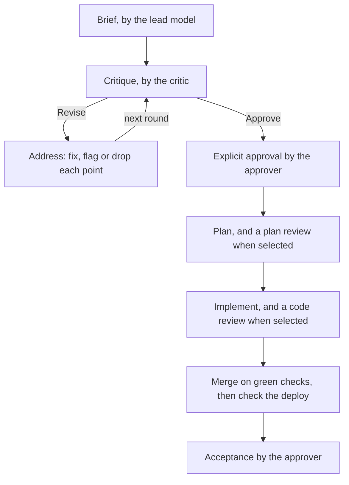

# Bollplank

Bollplank is a workflow kit for Claude Code and Codex. One model writes a ticket's brief, a model from another vendor critiques it, the author answers every point, and a named person approves it before anything is built. After approval, a ticket run can take the ticket from plan to shipped, with review gates on the way. Linear is the board.

The method comes from the article [Two Models and an Engineer](https://neologic.se/articles/two-models-and-an-engineer/). Its claim is that when code is cheap, the bottleneck moves to the specification, so the specification is where review pays off.

Bollplank is Swedish for a sounding board.

## The loop



The approver can approve after any round. A critic's Approve verdict is not an approval. The brief's `Cross-model review` line says which review stages are gates.

## The five workflow states

Each of the five states maps to a status of your Linear team. `bollplank init` asks for the names.

| State | What it means | Linear's suggested status |
|---|---|---|
| `draft` | The brief is being written and critiqued. | Draft |
| `ready` | The approver approved the brief. | Ready |
| `inProgress` | The ticket is being worked on. | In Progress |
| `acceptance` | Shipped, waiting for the approver's acceptance test. | Acceptance |
| `done` | Accepted. | Done |

A new Linear team has Backlog, Todo, In Progress, Done and Canceled. Add Draft, Ready and Acceptance in Linear's settings, or map those states to statuses you have.

## An example ticket

ACME-1, Acme and every name in it are made up.

**The brief**, in the issue's description:

```text
Brief v1
Responsible: Claude Code
Model: Claude Opus 5.5, effort high
Workflow: Bollplank 0.2.0, build 40
Last revised: 2026-11-02
Approval: Pending
Cross-model review: code. The change touches payments and stock.

## Why
Unpaid orders keep stock reserved for 14 days.

## Done when
- An unpaid order can be cancelled, and its stock is free again.
- The API refuses to cancel a paid order.
```

**The critique**, posted as a comment by the critic:

```text
Critique of brief v1
Reviewer: Codex
Model: gpt-6.1, high
Workflow: Bollplank 0.2.0, build 40
Date: 2026/11/02
Round: 1
Verdict: Revise

Blockers

1. Late payment. Severity High, likelihood Medium. A transfer that lands after
   the cancel leaves a paid, cancelled order. Say what happens to it.
```

**The response**, by the lead, with brief v2 in the description:

```text
Response to Codex's critique of brief v1
Responsible: Claude Code
Model: Claude Opus 5.5, effort high
Workflow: Bollplank 0.2.0, build 40
Outcome: Incorporated in brief v2

1. 1, Late payment. Accepted. The payment is held and support is told.
```

Round 2 came back `Verdict: Approve`. Ada wrote "I approve brief v2", the lead posted the approval comment, and the issue moved to Ready.

## Quickstart

You need a Mac with Node 20 or later and git, Claude Code or Codex or both signed in with a Claude or ChatGPT subscription, and a Linear account.

```sh
git clone https://github.com/ppanotzki/bollplank ~/.bollplank/kit && ~/.bollplank/kit/install.sh
```

The script links `bollplank` into `~/.local/bin` and starts `bollplank init`, which asks its questions and ends with `bollplank doctor`. Then, in a Claude Code or Codex session in your project, ask in plain words: "Write a brief for ...", "Critique ACME-1", "Address it", "I approve brief v2". [Getting started](docs/getting-started.md) walks through it with a first ticket.

## FAQ

### Why subscriptions only?

Bollplank never takes an API key and stores no credentials. The critic runs through the Claude Code or Codex command line client, signed in with your subscription, with model keys and provider settings removed from its environment. A client signed in with a key is not used.

### What can the critic reach?

Its client's Linear tools, to read the issue and post its critique, and the one source folder the lead opens for a plan or code review. No other MCP server, no web, no file edits. Claude Code gets no shell. Codex gets a shell in a read only sandbox with no network. See [SECURITY.md](SECURITY.md).

<!-- TERMS: confirm wording before publishing -->
### Bollplank drives my subscriptions from scripts. What does that mean?

The critic is a separate run of Claude Code or Codex, started by `bollplank critic` in print or exec mode, on the account the client is signed in to. `bollplank init` and `bollplank doctor` also start short headless runs to check that each client can read Linear. These runs count against your subscription like your own sessions. You run Bollplank on your own accounts, and you are responsible for using it within your provider's terms: [Anthropic's consumer terms](https://www.anthropic.com/legal/consumer-terms) for Claude, and [OpenAI's terms of use](https://openai.com/policies/terms-of-use/) for ChatGPT and Codex.

### What if I have only one client?

The critic is then the same model in a fresh session with a harder prompt. It is weaker, and labelled. See [same model mode](docs/same-model.md).

### Which boards and clients are supported?

Linear, Claude Code and Codex.

## Docs

- [Getting started](docs/getting-started.md): from install to a first approved ticket
- [An existing project](docs/existing-project.md): your own team, project and statuses
- [Setup](docs/setup.md): `init`, `doctor`, `update`, `uninstall`
- [Configuration](docs/config.md), [Commands](docs/commands.md), [Skills](docs/skills.md)
- [Ticket runs](docs/runs.md), [Same model mode](docs/same-model.md), [Windows](docs/windows.md)
- [Contributing](CONTRIBUTING.md), [Security](SECURITY.md), [Changelog](CHANGELOG.md)

## License

MIT. See [LICENSE](LICENSE).
